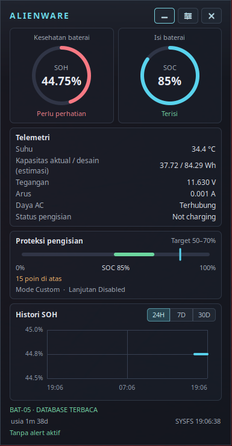

# Alienware Battery Control Center

An unofficial Linux battery monitoring backend and desktop dashboard for compatible Alienware laptops. This independent project has no affiliation with or endorsement from Dell or Alienware. Device and brand names identify compatibility.

## Features

- A systemd sampler records battery measurements and alerts to local SQLite. The dashboard reads live sysfs values every two seconds and queries SQLite read-only.
- The GTK 3 dashboard shows SOH, charge, electrical readings, firmware-reported charging limits and real history samples with 24-hour, 7-day and 30-day views.
- The GNOME Shell extension places the Wayland dashboard at the upper right and keeps it above other windows. Drag the header to move it. Settings include opacity.
- Charge protection is observational. Firmware attributes are read only.

Genuine R7.2 dashboard capture with PNG metadata removed. The displayed telemetry belongs to the capture session.

## Verified performance

On an Alienware m15 R7 running Ubuntu 26.04.1, GNOME 50 and Wayland, the accepted BAT-07R7.2 widget used **0.899% of one logical core** and **67.66 MiB peak sampled RSS** over **60.1 seconds** visibly idle. The PID and service invocation stayed stable, automatic restarts were zero, and sysfs telemetry refreshed every two seconds. This evidence covers the tested widget process. Total compositor overhead and performance on other hardware were outside the measurement.

The user-reported F001-R2 qualification on one offline Ubuntu 26.04.1 KVM guest with GNOME 50 Wayland and QXL/SPICE measured **0.483% of one logical core** and **70.69 MiB peak sampled RSS** over **60.1 seconds** visibly idle. GNOME autostart stayed active for ten seconds with zero automatic restarts, and the user confirmed all six UI/UX checks. This VM used synthetic battery inputs. See the [GH-05 evidence and limitations](evidence/GH05_QUALIFICATION.md).

## Operations and privacy

See [installation and removal](INSTALLATION.md), [compatibility](COMPATIBILITY.md), [architecture](ARCHITECTURE.md), and [troubleshooting](TROUBLESHOOTING.md). The project writes battery history and alert transitions locally, with a 365-day retention window applied during sampling. There is no upload, analytics, telemetry endpoint or account integration. User-readable database access is controlled by a dedicated local group. History and group membership survive uninstall. The journal and optional desktop notification daemon apply their own retention settings. See [security](SECURITY.md) for sharing and reporting guidance.

The project uses the [MIT License](LICENSE). [Release review](RELEASE_REVIEW.md) records the blockers for publication.
